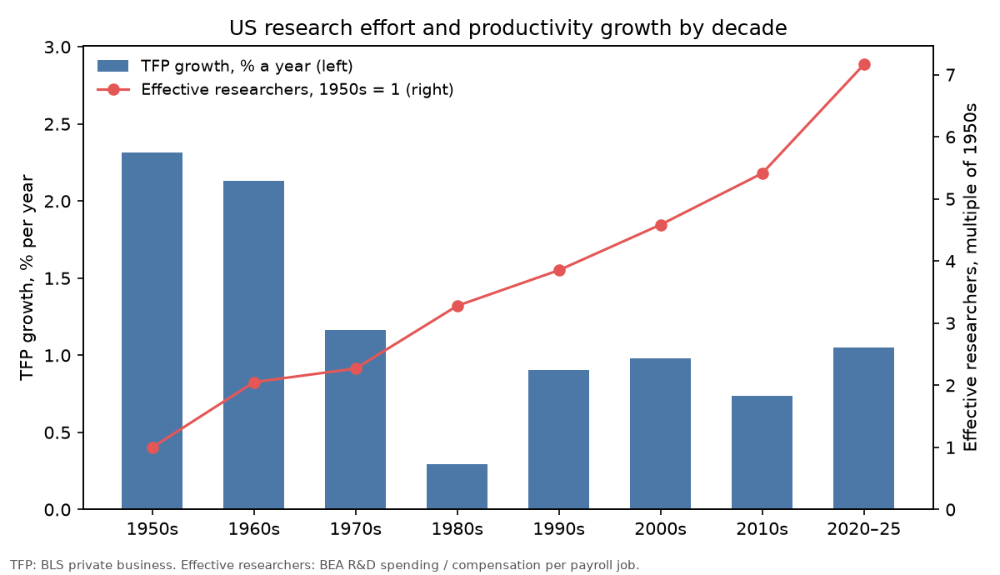
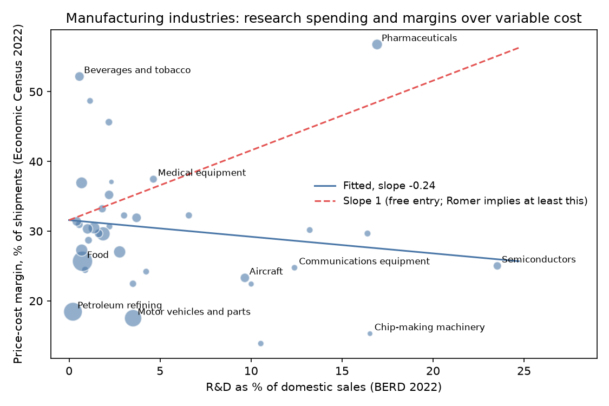

# The Price of New Ideas

### In 1990 Paul Romer argued that growth comes from new designs, and that the monopoly markup on each design is what pays for the research behind it. I checked both halves against American data.

---

The pharmaceutical plants of Eli Lilly, Merck, Pfizer and their smaller rivals shipped $234 billion of medicines
from American factories in 2022. After paying for every chemical, vial and carton and every worker in the plants,
57 cents of each dollar was left over. Pharmaceutical companies spent $116 billion that year on research and
development in the United States, 16.9% of their domestic sales. A pill sells for more than twice what the next one
costs to make, and in Romer's account that gap is what pays for
designing it.

That arrangement is the heart of one of the most cited growth models in economics. Paul Romer, then at
the University of Chicago, argued that long-run prosperity comes from new ideas, that ideas are expensive to
create and nearly free to copy, and that the only way a market economy can pay for them is by letting their
owners charge more than the cost of production. If he is right, two things should be visible in the data. The more
people a country puts to work on research, the faster its productivity should grow. And the industries that spend
the most on research should be the ones with the widest margins between price and cost.

---

## Measuring research and its reward

The first number counts the effort a country devotes to new ideas. Romer measured it in people. Following
Nicholas Bloom, Charles Jones, John Van Reenen and Michael Webb, who did this exercise in 2020, I count "effective researchers" as the number of college-educated workers that
the nation's research budget could hire:

```math
S_t = \frac{\text{R\&D spending}_t}{w_t}
```

Here $`\text{R\&D spending}_t`$ is all US research and development in year $`t`$, business and government,
as the Bureau of Economic Analysis counts it, and $`w_t`$ is the mean income of a man aged 25 or older
with four or more years of college, from the Census Bureau's Current Population Survey. In 2025:

```math
S_{2025} = \frac{\$1{,}088.2 \text{ billion}}{\$136{,}400} = 7.98 \text{ million effective researchers}
```

In 1970 the same calculation gives $28.3 billion divided by $14,434, or 1.96 million. The count is an index of
effort rather than a head count, since R&D budgets also buy laboratories and equipment.

The second number is what each unit of that effort produces. Economists measure the output of new ideas as growth
in total factor productivity (TFP), the part of output growth that more workers and more machines cannot explain.
Research productivity is the ratio of the two:

```math
\theta_t = \frac{g_t}{S_t},
\qquad
g_t = 100 \times \Delta \ln \text{TFP}_t
```

where $`g_t`$ is TFP growth in percent a year. Romer's model says $`\theta_t`$ is a constant, so that doubling the
researchers doubles growth.

The third number is the one that pays for research. A firm's price-cost margin is the share of its sales left after
paying for materials and the whole payroll, a standard measure built from Census data. If marginal cost is constant,
so that it equals average variable cost, the margin translates directly into a markup of price over marginal cost:

```math
\text{PCM} = \frac{\text{value added} - \text{payroll and benefits}}{\text{shipments}},
\qquad
\frac{P}{MC} = \frac{1}{1 - \text{PCM}}
```

For pharmaceutical plants in 2022 the Economic Census reports $173.0 billion of value added, $40.0 billion of payroll
and benefits and $234.2 billion of shipments:

```math
\text{PCM} = \frac{173.0 - 40.0}{234.2} = 0.568,
\qquad
\frac{P}{MC} = \frac{1}{1 - 0.568} = 2.31
```

| Industry, 2022 | Price-cost margin | Price per $1 of marginal cost |
|---|---|---|
| Petroleum refining | 18.5% | $1.23 |
| Semiconductors | 25.0% | $1.33 |
| Pharmaceuticals | 56.8% | $2.31 |

Even an industry with no research shows a positive margin, because the margin also pays for plant and equipment,
advertising and headquarters.

---

## Paul Romer's designs

Paul Romer was born in Denver in 1955 and took his doctorate at the University of Chicago in 1983. He taught at
Rochester, Chicago, Berkeley and Stanford, served as chief economist of the World Bank, and spent thirteen years at
New York University before moving to Boston College in 2023. In 2018 he shared the Nobel Prize in economics with William Nordhaus. Romer's citation
reads "for integrating technological innovations into long-run macroeconomic analysis."

"Endogenous Technological Change" appeared in the *Journal of Political Economy* in October 1990, and Crossref now
records more than 15,000 citations of it. Its starting point is a distinction between rival goods, which only one person can use at a time, and nonrival ones. A design for a hard
disk drive, Romer's own example, can be used in every factory at once. Once the cost of creating it has been paid,
copying it is nearly free. He showed that an economy built on nonrival designs cannot work under perfect
competition. If every input were paid its marginal product, the rival inputs would absorb all the revenue and
nothing would be left over to pay for the design.

His solution was a model with three sectors. Researchers create designs. Each design is bought by a firm that
becomes the sole producer of a new capital good, which it rents to final-goods producers at a monopoly price. And
anyone may enter research, so the price of a design is bid up until it just equals the present value of the profits it will earn.

The central result takes four lines. Assume, as Romer did, that new designs $`A`$ are produced by human capital in
research $`H_A`$ with productivity $`\delta`$, that every researcher builds on the whole existing stock of designs,
and that final output uses human capital $`H_Y`$, labor $`L`$ and an amount $`x`$ of each of the $`A`$ durable
goods, with exponents $`\alpha`$ and $`\beta`$ on human capital and labor and $`1-\alpha-\beta`$ on each durable.
Each unit of a durable takes $`\eta`$ units of capital $`K`$ to make, and in a symmetric equilibrium every durable
is supplied in the same quantity $`\bar{x}`$:

```math
\begin{aligned}
\dot{A} &= \delta H_A A \quad\Longrightarrow\quad g_A = \frac{\dot{A}}{A} = \delta H_A \\
Y &= H_Y^{\alpha} L^{\beta} A\,\bar{x}^{\,1-\alpha-\beta}, \qquad \bar{x} = \frac{K}{\eta A} \\
Y &= \eta^{\alpha+\beta-1}\,(H_Y A)^{\alpha} (L A)^{\beta} K^{1-\alpha-\beta} \\
g_{\text{TFP}} &= (\alpha+\beta)\,g_A = (\alpha+\beta)\,\delta\,H_A
\end{aligned}
```

The first line is Romer's research equation. The second and third say that once capital is counted as an input,
designs act like labor-augmenting technology. If TFP is measured, as the BLS does, by weighting each input with its
income share, measured TFP is proportional to $`A^{\alpha+\beta}`$ and its growth, the fourth line, is proportional
to the number of people doing research. That is the prediction tested below.

The monopoly half is just as short. Each producer of a capital good faces the demand
$`p = (1-\alpha-\beta)H_Y^{\alpha}L^{\beta}x^{-(\alpha+\beta)}`$ and pays the interest rate $`r`$ on the $`\eta`$
units of capital each unit of output ties up:

```math
\begin{aligned}
\pi &= \max_x\; p(x)\,x - r\eta x \\
p &= \frac{r\eta}{1-\alpha-\beta} \\
\pi &= r P_A
\end{aligned}
```

The second line is the monopoly price, a fixed markup of $`1/(1-\alpha-\beta)`$ over marginal cost. The third is the
free-entry condition from the paper, which says the flow of profit on a design just covers the interest on its price
$`P_A`$. Markups exist in this economy precisely to pay for research, and in equilibrium they pay for no more than that.

Romer concluded that growth depends on the stock of human capital rather than on population, and that too little
of it goes into research, because inventors cannot charge for what later inventors learn from their designs.

The strongest objection came five years later from Charles Jones, now at Stanford. In a 1995 *Journal of Political Economy* paper he pointed out that US research
effort had risen enormously while productivity growth had not, which the research equation does not allow. Jones proposed a "semi-endogenous" alternative in which ideas get harder to find,
so that growth depends on how fast research effort grows rather than on its level. Bloom, Jones, Van Reenen and Webb
reported in the *American Economic Review* in 2020 that US research effort had risen by a factor of 23 since the
1930s while research productivity had fallen by a factor of 41, or 5.1% a year. Defenders of the fully endogenous view in the Schumpeterian tradition, such as
Joonkyung Ha and Peter Howitt in 2007, answer that research is spread over an ever larger number of product lines,
so effort per line has grown much less than the total.

The question matters because it decides what keeps growth going. If Romer's equation holds, a permanent increase in
research spending buys a permanently faster economy. If Jones is right, it buys a one-time boost, and sustaining
growth requires research effort that rises forever.

---

## How I tested it

Romer's paper contains no data, so I rebuilt the aggregate test in Bloom and coauthors. Output is annual growth in the Bureau of Labor Statistics measure of TFP for the private business
sector, 1949 to 2025. Effort is total US R&D from the BEA, divided either by the mean income of college-educated men
(from 1967, the closest public match to Bloom and coauthors' deflator) or by average compensation per payroll job
(from 1948). As checks I also used BEA investment in all intellectual property products, Bloom and coauthors' own
input, and the OECD's count of full-time-equivalent US researchers, which starts in 1991. The research equation implies:

```math
\begin{aligned}
g_t &= a + b\,S_t + \varepsilon_t,
\qquad H_0^{\text{Romer}}\colon\ a = 0,\ b > 0 \\
\ln\theta_k &= c + d\,\text{year}_k + u_k,
\qquad H_0^{\text{Romer}}\colon\ d = 0
\end{aligned}
```

The first line is estimated on annual data with Newey-West standard errors allowing for four years of serial
correlation, and again on non-overlapping five-year averages with heteroskedasticity-robust (HC1) standard errors.
The second uses five-year blocks $`k`$, so $`d`$ is the annual rate at which research productivity changes. I also
regressed $`g`$ on the growth rate of $`S`$, which is what Jones's alternative says should matter.

For the extension I tested the free-entry condition across manufacturing industries. Summed over the $`A_i`$
designs in industry $`i`$, rents are $`\Pi_i = r P_A A_i`$ and research spending is $`R_i = P_A \dot{A}_i`$, so
that

```math
\begin{aligned}
\frac{\Pi_i}{R_i} &= \frac{r}{g_{A,i}}
\quad\Longrightarrow\quad
\frac{\Pi_i}{Q_i} = \frac{r}{g_{A,i}} \cdot \frac{R_i}{Q_i}
\end{aligned}
```

where $`Q_i`$ is sales and $`g_{A,i}`$ is the growth rate of the industry's designs. On Romer's balanced path
$`r = \rho + \sigma g`$, with $`\rho`$ the rate of time preference and $`1/\sigma`$ the intertemporal elasticity
of substitution, so $`r \ge g`$ whenever $`\sigma \ge 1`$. If $`r/g_{A,i}`$ is similar across industries, margins
over variable cost must rise at least one for one with R&D intensity:

```math
\text{PCM}_i = a + b\,\text{RD}_i + \gamma_1 \frac{K_i}{Q_i} + \gamma_2 \frac{\text{Adv}_i}{Q_i} + e_i,
\qquad H_0^{\text{Romer}}\colon\ b = 1
```

I test $`b = 1`$, the lower end of what free entry allows. $`\text{PCM}_i`$ comes from the 2022 Economic Census of manufacturing, and $`\text{RD}_i`$, R&D as a share of sales,
from the 2022 Business Enterprise Research and Development Survey run by the National Science Foundation and the
Census Bureau. $`K_i/Q_i`$ is gross plant and equipment over shipments and $`\text{Adv}_i/Q_i`$ is advertising over
shipments; the capital term matters because the Census margin is measured before the rental cost of capital. I used
the 36 most detailed manufacturing industries in the R&D survey that do not overlap, matched them to Census industry
codes, and computed HC1 standard errors. A price-taking industry with no rents would show $`b = 0`$. I had planned a
firm-level version on SEC filings, but the SEC's servers refused every request from my connection.

---

## Research effort rose sevenfold while productivity growth halved

| Decade | TFP growth, % a year | Researchers, college wage, millions | Researchers, average wage, 1950s = 1 | Research productivity, average wage, 1950s = 1 |
|---|---|---|---|---|
| 1950s | 2.31 | | 1.00 | 1.00 |
| 1960s | 2.13 | | 2.05 | 0.45 |
| 1970s | 1.17 | 2.07 | 2.27 | 0.22 |
| 1980s | 0.29 | 3.13 | 3.28 | 0.04 |
| 1990s | 0.91 | 3.54 | 3.85 | 0.10 |
| 2000s | 0.98 | 4.41 | 4.58 | 0.09 |
| 2010s | 0.74 | 5.73 | 5.41 | 0.06 |
| 2020–25 | 1.05 | 7.80 | 7.16 | 0.06 |

Measured against the average wage, the United States put 7.2 times as much into
research in 2020 to 2025 as in the 1950s, and productivity grew less than half as fast. Measured against the
income of college-educated men, effort grew 3.8 times between the 1970s and 2020 to 2025. The OECD's head count tells the same story over a shorter span. The United States had 822,350
full-time-equivalent researchers in 1991 and 1,733,124 in 2023, 2.1 times as many, while TFP growth slipped from 1.01%
a year over 1991 to 2000 to 0.80% over 2014 to 2023.



The regressions find no sign of Romer's proportionality. With the college-wage measure, annual data from 1967 to
2025 give:

```math
\hat{b} = 0.009\ (0.071),\quad p = 0.90,\quad N = 59;
\qquad
\hat{a} = 0.80\ (0.39)
```

With the average-wage measure from 1949, the slope is negative, $`\hat{b} = -0.151`$ (0.067), $`p = 0.023`$,
$`N = 77`$, and the five-year averages give $`-0.175`$ (0.072). The OECD head count gives a slope of $`-0.004`$
(0.511). In every version the slope is either indistinguishable from zero or the wrong sign.

---

## Research productivity has fallen about 4 percent a year since 1950

| Effort measure | From | To | Effort rose by | Research productivity fell to | Change per year |
|---|---|---|---|---|---|
| R&D ÷ college wage | 1970s | 2010s | 2.8× | 0.23 | −3.7% |
| All IP investment ÷ college wage | 1970s | 2010s | 3.9× | 0.16 | −4.6% |
| R&D ÷ average wage | 1950s | 2010s | 5.4× | 0.059 | −4.7% |
| R&D ÷ GDP price index | 1950s | 2010s | 11.6× | 0.028 | −6.0% |
| Bloom et al. (2020), IP ÷ college wage | 1930s | 2000–2014 | 23× | 1/41 | −5.1% |

Each row compares decade averages. The measure closest to Bloom and coauthors' own, intellectual property
investment over the college wage, gives a decline of 4.6% a year against their 5.1%. My span starts
four decades later and so cannot show the full factor of 41. The trend regression on five-year blocks is:

```math
\hat{d} = -0.042\ (0.008),\quad 95\%\ \text{CI}\ [-0.058,\ -0.026],\quad N = 15
```

which says research productivity has fallen about 4.2% a year since 1950 with the average-wage measure. With the
college-wage measure from 1970 the estimate is $`-0.018`$ (0.015), $`p = 0.22`$, $`N = 11`$, smaller and imprecise,
largely because the 1970s already had slow growth and the sample is short. The direction is the same in every version
and the size depends heavily on where the clock starts.

Jones's alternative fits better on the full sample, but the fit is fragile. Regressing five-year TFP growth on the
growth rate of effective researchers gives a slope of 0.114 (0.043), $`p = 0.009`$, $`N = 14`$, with an R-squared of
0.26. All of that fit comes from two blocks, 1955 to 1959 and 1960 to 1964, when research budgets grew fastest and
TFP grew fast too. Without them the slope is $`-0.012`$ (0.091), $`p = 0.89`$, $`N = 12`$, so the data do not
separate Jones's version from no relation at all.

---

## Manufacturing margins do not rise with research spending

| Industry | Well-known companies | R&D, % of sales | Price-cost margin | Margin left after R&D |
|---|---|---|---|---|
| Semiconductors | Intel, Micron, Texas Instruments | 23.5% | 25.0% | 1.5% |
| Pharmaceuticals | Eli Lilly, Merck, Pfizer, AbbVie | 16.9% | 56.8% | 39.9% |
| Chip-making machinery | Applied Materials, Lam Research, KLA | 16.5% | 15.3% | −1.2% |
| Communications equipment | Cisco, Motorola Solutions | 12.4% | 24.8% | 12.4% |
| Aircraft, engines and parts | Boeing, GE Aerospace, RTX | 9.7% | 23.3% | 13.6% |
| Medical equipment and supplies | Stryker, Becton Dickinson | 4.6% | 37.5% | 32.8% |
| Motor vehicles and parts | General Motors, Ford, Tesla | 3.5% | 17.5% | 14.0% |
| Food | Tyson, Kraft Heinz, General Mills | 0.7% | 25.7% | 24.9% |
| Beverages and tobacco | Altria, Molson Coors | 0.6% | 52.2% | 51.6% |
| Petroleum refining | ExxonMobil, Marathon, Valero | 0.2% | 18.5% | 18.2% |

*The Census and the R&D survey publish industry totals and never name companies. The names are each industry's
well-known leaders. R&D intensity is a share of the R&D survey's company sales and the margin a share of Census
plant shipments, so the last column is an approximation.*

Pharmaceuticals fit Romer's story closely, with large research budgets, a wide margin and plenty left over after
paying for research. The rest of the table does not. Semiconductor plants and the makers of
chip-making machinery spend as much on research, relative to sales, as drug companies, yet their factories earn ordinary margins, and after paying for research
almost nothing is left. Brewers and cigarette makers spend 0.6% of sales on research and earn a margin of 52.2%, one of
the widest in American manufacturing.

Across all 36 industries the slope is:

```math
\hat{b} = -0.24\ (0.34),\quad 95\%\ \text{CI}\ [-0.91,\ 0.44],\quad
p_{b=1} < 0.001,\quad N = 36
```

A slope of one, the smallest that Romer's free-entry condition allows, is rejected, and the estimate is not
distinguishable from zero. Adding capital and advertising intensity leaves it at $`-0.25`$ (0.27), while advertising
itself enters strongly, 20.9 (8.2), so margins track spending on brands more closely than spending on research. Dropping pharmaceuticals turns the slope
significantly negative, $`-0.56`$ (0.22). Weighting industries by shipments raises it to 0.52 (0.56), close enough to 1 that the
test cannot reject Romer, and too imprecise to reject zero either. The third of industries with the most research,
which spend 12.1% of sales on it, average a margin of 27.9%. The third with the least, at 0.8% of sales, average
32.1%.



Part of the gap may come from where things are measured. The R&D survey classifies whole companies; the Census
measures American factories. In the "other computer and electronic products" group, which includes
computer makers, R&D-performing companies reported $309.2 billion of domestic sales while American plants in the
same industry shipped only $26.5 billion. Devices designed here and built abroad earn margins that never pass through a
Census factory.

---

## Why it matters

For consumers, medicine shows Romer's bargain in its plainest form. A branded drug carries a high markup because
its designer is a monopolist while the patent lasts, and that markup finances the research. Elsewhere in
manufacturing, wide margins are at least as often a return to brands and established positions.

For workers, the falling productivity of research means that keeping wages growing requires an ever larger share of
the workforce in laboratories and engineering departments. The number of effective researchers grew about 2.8% a
year from the 1950s to the 2010s, and TFP growth still fell from 2.31% to 0.74% a year.

For smaller firms, Romer's model says entry comes through new designs. In semiconductors and chip-making
equipment, research already absorbs almost the whole factory margin, which leaves an entrant little room to recover
its own research bill.

For policy, research effort has not bought the permanent acceleration in growth that Romer's equation promises,
and markups do not line up with research spending across most of manufacturing. Nonrival ideas still need some way
to be paid for, and his case for subsidizing research, because inventors cannot capture what later inventors learn,
is untouched by these tests. What the data reject is the simplest version, in which more researchers mean
proportionally faster growth and margins exist only to cover research.

---

## Limits of this study

TFP growth is a residual that absorbs everything the BLS cannot measure, including reallocation of capital and
workers, so it is a rough stand-in for the flow of new designs. The effort measures count dollars, not
ideas, and only American dollars, although American firms build on research done everywhere. The college-wage series
splices two Census tables at 1990, and the decade averages are sensitive to the slow-growth 1980s. The industry test
is a single cross-section of 36 industries, and the R&D survey and the Economic Census classify companies and
factories differently, as the computer example shows. Industry margins also include returns to capital, brands and
headquarters spending that the model leaves out, and the SEC's refusal ruled out a firm-level version. None of this shows that research does not cause growth, only that the proportional link Romer wrote
down does not appear in more than seventy years of American data.

---

## Further reading

- [TECHNICAL.md](TECHNICAL.md) has the data, method, test statistics and reproduction steps.
- [results/FINDINGS.md](results/FINDINGS.md) has every table the scripts produce.
- [METHODS_REVIEW.md](METHODS_REVIEW.md) reviews the original paper's assumptions and formal results.
- The original paper is Paul M. Romer, "Endogenous Technological Change," *Journal of Political Economy* 98(5, Part 2),
  October 1990, pp. S71–S102. The NBER working paper version (No. 3210, December 1989) is free.
- Charles I. Jones, "R&D-Based Models of Economic Growth," *Journal of Political Economy* 103(4), 1995, pp. 759–784.
- Nicholas Bloom, Charles I. Jones, John Van Reenen and Michael Webb, "Are Ideas Getting Harder to Find?" *American
  Economic Review* 110(4), 2020, pp. 1104–1144.
- TFP, R&D, intellectual property investment, compensation, payroll employment and the GDP deflator are BLS and BEA
  series from FRED, downloaded November 1, 2026.
- College incomes are from US Census Bureau Current Population Survey historical income tables P-18 and P-19.
- Researcher counts are from the OECD Main Science and Technology Indicators.
- Industry R&D and sales are from the 2022 Business Enterprise Research and Development Survey (NCSES publication
  NSF 24-335, Tables 2 and 8), and industry margins from the 2022 Economic Census of manufacturing (EC2231BASIC).

*Brendyn Beasley*
